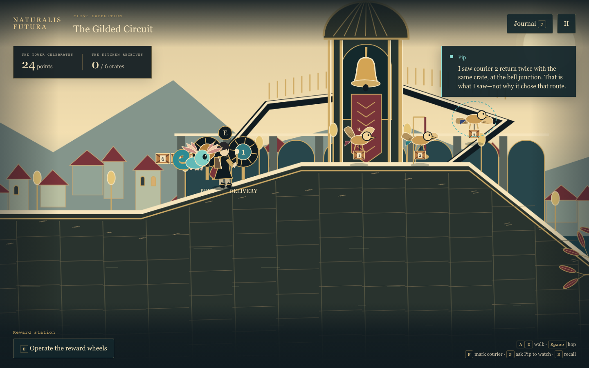

# The Gilded Circuit — first playable slice

**Integration and creative direction:** start with [The Latent Wilds handoff](latent-wilds/README.md), including four concept boards, Pip, the receiving-agent brief and an honest comparison of this prototype with the intended game. The prototype is a mechanical foundation, not the final art target.

Run `npm ci`, `npm run dev`, then open `/expedition`. The original atlas remains at `/` and links to the expedition from its arrival screen. Node 22.18 or later is needed for the dependency-free simulation tests (`npm test`). Run `npm run typecheck` and `npm run build` for application checks.

Walk with A/D or arrows, hurry with Shift, hop with Space, investigate with E. F marks a nearby courier; P asks Pip to watch it; R recalls Pip. J opens the journal; Escape pauses. Every menu pauses the town. The pause menu includes mute, reduced camera motion, lower visual effects and a measured frame-time reading. Keyboard and a landscape desktop viewport are the intended input surface for this first slice; touch movement is not implemented.

Three couriers carry six individually tracked crates. The initial bell circuit pays four points per 16-second trip; verified delivery pays one per 24-second trip. Couriers choose at the junction, retain cargo on a loop, and unload physically before a crate counts as delivered. Rewards changed mid-trip affect the next decision. Lowering bell rewards, increasing delivery rewards, or temporarily damping the bell can restore service. Three real deliveries provision the ferry, light the kitchen, and bring neighbors to dinner.

Pip follows a marked courier and records only events within its observation radius. It returns after observing the same cargo complete two loops, or reports a lost trail. It cannot read the route policy. Comparison trials reconstruct the seeded start, preserve discoveries, and restore the untouched real town afterward. The local save uses a new validated `naturalis-futura:gilded-circuit:v1` slot; the atlas's saves are untouched.

This is an authored policy, not a trained agent or research reproduction. Its optional research note links to OpenAI's [2016 CoastRunners account](https://openai.com/index/faulty-reward-functions/). All canvas environments and articulated characters are original procedural vector art; sound cues are original Web Audio tones. No concept plate is used as a playable backdrop, no third-party game art is included, and no model calls are needed. System serif and monospace fonts remove build-time Google font requests.

The intended full expedition pace is 10–15 minutes, not a measured first-player result. An informed player can finish much faster. The Drowned Archive is a narrative invitation, not a second implemented region. This first slice still needs independent newcomer comprehension testing, richer art and sound direction, and touch controls before a broad release. Procedural art and basic tones do not claim the finish of the concept plates.
