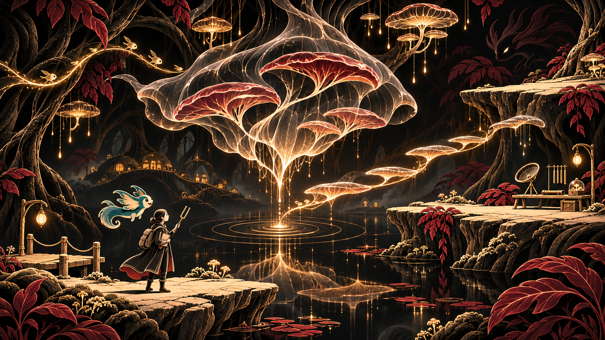
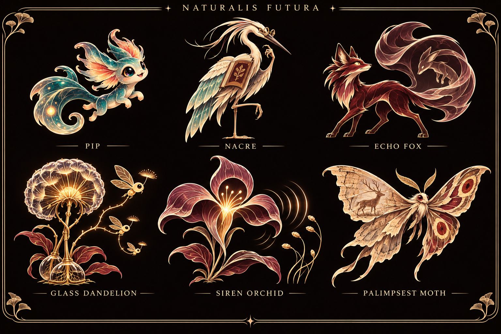
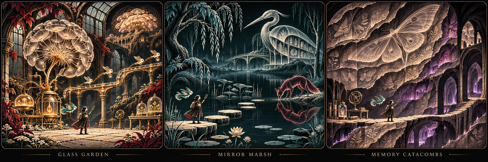
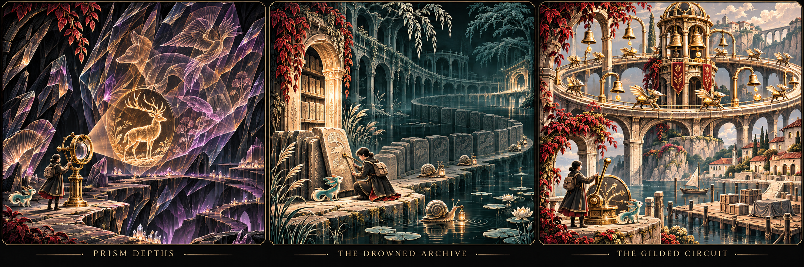
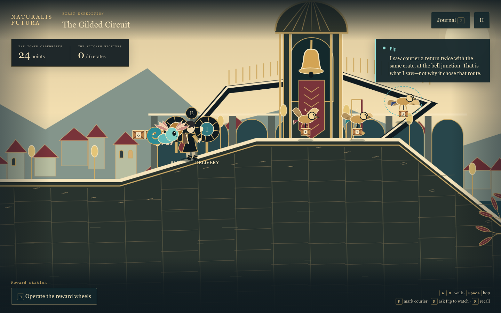

# Naturalis Futura: the Latent Wilds

**A living natural-history book you can walk into.** Explore unfamiliar minds with an artificial companion. Discover how their world behaves, make instruments, test your theories, and return with something that changes somebody's life.

This is the creative and integration handoff accompanying [PR #7](https://github.com/elder-plinius/NATURALIS-FUTURA/pull/7). It is for the agent already developing Naturalis Futura, including work not present on this PR's base. Integrate the vision into the strongest existing game; you do not need to adopt this prototype's renderer, camera or entry point.

## Start here

1. Open the [visual reference gallery](index.html), or view the plates below on GitHub.
2. Read [the receiving-agent brief](AGENT-HANDOFF.md) and [the honest prototype review](PROTOTYPE-REVIEW.md).
3. Read [game direction](GAME-DIRECTION.txt) and [the first expedition](FIRST-EXPEDITION.txt).
4. Use [art and mythological direction](reference/ART-DIRECTION.txt), [eight research landscapes](reference/RESEARCH-LANDSCAPES.txt), and their [source-scoped records](reference/RESEARCH-LANDSCAPES.json).
5. Build and review against the [quality gates](QUALITY-GATES.txt), not the prototype screenshot as a finish target.

The documents and images are bundled here. They require neither the originating chat nor another developer's local folders. The HTML gallery opens locally with no network requests. GitHub displays its source; the images below are directly viewable there.

## The visual ambition

Ink-dark depth, ivory forms, fine brass/gold linework, oxblood foliage, and a warm light where people gather. Intimacy, danger and wonder. A place you want to enter even before anyone explains the research.

Creatures need readable silhouettes, motives and behavior—not just elaborate portraits. Pip's established identity is teal/opal with peach ear gills and a curled comet tail. The [earlier single-pose identity reference](art/pip-identity-reference.png) preserves those cues; adapt its finish to the environment rather than importing its glitter literally.

The Gilded Circuit can be sunlit: the target is layered atmosphere, material richness and a meaningful silhouette hierarchy, not compulsory darkness everywhere. Hollow Knight informs intimacy, animation clarity and the desire to explore. Do not copy its characters, assets or world.

These are original AI-generated concept studies, **not layered game assets, animation sheets or implemented regions**. See [asset provenance](ASSETS.md). Preserve their visual intent while simplifying for motion and performance.

## What the current PR is—and isn't

The PR establishes a functioning research puzzle: couriers maximize a score while failing to deliver supplies; the player observes, intervenes and sees a consequence. It has useful simulation, observation, save and recovery foundations.

**It does not yet deliver the illustrated world above.** Flat mountain polygons, repeated house shapes, schematic actors and a largely linear route undersell the world. The simulation should survive integration where useful; the presentation should earn its place against the concept references. This package strengthens the direction carried by the PR. It does not claim that adding reference art upgrades the playable graphics.

## The non-negotiable experience

- Research lives in creature behavior and the environment. Reading a dossier is optional, not the main game loop.
- Explore, notice, hypothesize, change a condition, compare, choose, and see an inhabited place respond.
- Pip is a useful, situated companion with incomplete knowledge, expressed through action and personality.
- Myths provide familiar archetypes without requiring one pantheon. Stories, observations and scientific claims remain distinct.
- Danger has readable signals and opportunities for understanding. Warmth and humor prevent a monotonous doom aesthetic.
- Build one wonderful complete expedition before expanding into an encyclopedia of unfinished rooms.
- Core play works offline without an AI account. Optional generation can enrich grounded dialogue or validated variation later.
- The existing eight territories and Lysios's nine heads are different structures. Neither must become a rigid combat-class scheme.

## First strong result

Deliver one continuous, playable arrival-to-consequence sequence with a distinctive location, convincing character acting, one reproducible mystery and a reason to care about its outcome. Show an uncut playthrough including a mistaken hypothesis and recovery. Report what was directly inspected, what tests prove, and what still needs an independent player.

No merge, deployment, purchase or paid inference is implied by this handoff. Preserve existing development and recoverable history.
